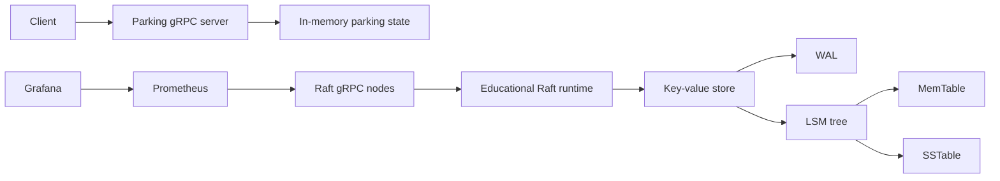

# Real-Time Distributed Smart Parking Availability Management System

## Aim

Demonstrate a Go-based smart-parking service alongside educational implementations of a key-value store, WAL, LSM tree, gRPC, and a multi-node Raft runtime. Docker and Kubernetes manifests package and run the Raft nodes; Prometheus and Grafana provide Raft-node monitoring.

## Problem statement

Parking availability changes frequently and needs to be queryable by clients. This project explores the storage, RPC, replication, deployment, and observability building blocks that could support such a system. It is a learning/demo project, not a production parking control system.

## Architecture



The parking gRPC service and the Raft cluster are separate executables in the current implementation. Parking ENTER/EXIT calls do not currently become Raft commands. See [docs/architecture.md](./docs/architecture.md) for implementation details and limitations.

## Technologies

- Go 1.27
- gRPC and Protocol Buffers
- Raft election and replication demo
- Key-value store, WAL, and LSM components
- Docker, Kubernetes StatefulSet, and Helm
- Prometheus metrics and Grafana dashboard

## Features

- Parking ENTER, EXIT, and STATUS gRPC methods
- Browser-based parking demo and JSON HTTP API
- Key-value store with optional WAL and LSM integrations
- MemTable, SSTable, Bloom filter, tombstone, and compaction components
- Raft RequestVote and AppendEntries RPCs, elections, and heartbeats
- Three-node StatefulSet and headless peer-discovery service
- Raft term, leadership, log, RPC count, and RPC latency metrics
- Configurable concurrent parking-service stress client

## Project structure

```text
cmd/                 Raft node, parking server/client, stress client
grpc/                Parking gRPC service
kv/                  Key-value store
lsm/                 LSM tree components and benchmarks
parking/             Parking state machine
proto/               Protocol Buffer source and generated Go files
raft/                Raft state, network runtime, metrics, and tests
wal/                 Write-ahead log
k8s/                 Raw Kubernetes manifests
helm/smart-parking/  Helm chart
monitoring/          Prometheus and Grafana manifests
docs/                Architecture, performance, and fault-test notes
```

## Run locally

Use a Go 1.27 toolchain:

```powershell
go test ./...
go test -race ./...
go build ./...
```

Start the parking gRPC server in one terminal:

```powershell
go run ./cmd/server
```

Use the client in another terminal:

```powershell
go run ./cmd/client status slot-1
go run ./cmd/client enter slot-1 vehicle-1
go run ./cmd/client exit slot-1 vehicle-1
```

Run concurrent ENTER/EXIT requests against a running parking server:

```powershell
go run ./cmd/stress -address localhost:50051 -clients 100 -operations 1000
```

`operations` is the number of parking cycles per client; a successful cycle issues one ENTER and one EXIT RPC. The stress tool reports actual attempted/successful/failed requests, elapsed time, throughput, and mean RPC latency.

## Build the Raft Docker image

From the project directory:

```powershell
docker build -f Dockerfile.raft -t smart-parking-raft:latest .
```

Build the public-demo HTTP application image:

```powershell
docker build -f Dockerfile.app -t smart-parking-web:latest .
```

## Deploy to Kubernetes

The image must be present inside the Kubernetes node's containerd image store. With a `kind` CLI:

```powershell
kind load docker-image smart-parking-raft:latest --name desktop
```

If `kind` is unavailable but the node container is named `desktop-control-plane`, the following PowerShell sequence imports the image directly:

```powershell
$archive = Join-Path $env:TEMP 'smart-parking-raft-image.tar'
docker image save --output $archive smart-parking-raft:latest
& $env:ComSpec /c "docker exec -i desktop-control-plane ctr -n k8s.io images import - < `"$archive`""
Remove-Item -LiteralPath $archive -Force
```

Apply the raw Kubernetes deployment:

```powershell
kubectl apply -f k8s/raft-config.yaml
kubectl apply -f k8s/raft-node.yaml
kubectl rollout status statefulset/raft-node --timeout=180s
kubectl get pods -o wide
```

The StatefulSet uses `imagePullPolicy: Never`, so load each newly built image before rollout. The raw Kubernetes deployment exposes Raft RPC on port 6000 and metrics on port 8080.

## Helm deployment

Install Helm, then lint and install the chart:

```powershell
helm lint helm/smart-parking
helm upgrade --install raft-node ./helm/smart-parking --namespace parking --create-namespace
helm list --namespace parking
kubectl get pods,statefulset,svc --namespace parking
```

Use the release name `raft-node` for the documented stable pod names. The
chart sets each Raft node ID from its StatefulSet ordinal and retains the
hostname-derived fallback. The chart includes the browser-friendly parking HTTP app
(internal `ClusterIP` by default) in addition to the Raft StatefulSet. AKS
image publishing, ingress/TLS, and public deployment steps are documented in
[docs/aks-deployment.md](./docs/aks-deployment.md). Parking state is currently
in-memory and separate from Raft; this is a demo endpoint, not a durable,
replicated parking service.

The Helm chart is an alternative to the raw Raft manifests. Avoid running both deployments at once unless two separate three-node clusters are intentional.

## Prometheus and Grafana

Apply the monitoring configuration after the raw Raft deployment is running:

```powershell
kubectl apply --namespace parking -f monitoring/prometheus-rbac.yaml
kubectl apply --namespace parking -f monitoring/prometheus-config.yaml
kubectl apply --namespace parking -f monitoring/prometheus-deployment.yaml
kubectl apply --namespace parking -f monitoring/prometheus-service.yaml
kubectl apply --namespace parking -f monitoring/grafana-config.yaml
kubectl apply --namespace parking -f monitoring/grafana-deployment.yaml
kubectl apply --namespace parking -f monitoring/grafana-service.yaml
kubectl rollout status deployment/prometheus --namespace parking --timeout=180s
kubectl rollout status deployment/grafana --namespace parking --timeout=180s
```

Open local port-forwards in separate terminals:

```powershell
kubectl port-forward --namespace parking svc/prometheus 9090:9090
kubectl port-forward --namespace parking svc/grafana 3000:3000
```

Prometheus is at `http://localhost:9090`; Grafana is at `http://localhost:3000`. Grafana's initial login is `admin` / `admin`; change the password for any use beyond a local demo. The provisioned dashboard is **Smart Parking Raft Cluster**.

## Fault injection

Delete a Raft pod and wait for its StatefulSet replacement:

```powershell
kubectl delete pod raft-node-1
kubectl wait --for=condition=Ready pod/raft-node-1 --timeout=180s
kubectl get pods -o wide
```

See [docs/fault-testing.md](./docs/fault-testing.md) for the observed recovery run and its limitations.

## Testing

```powershell
go test ./...
go test -race ./...
go build ./...
```

The stress client has a local gRPC integration test that exercises concurrent parking requests without requiring a separately running server.

## Benchmarking and profiling

```powershell
go test -bench=. -benchmem ./lsm
```

Performance numbers must be recorded with the machine/toolchain context; see [docs/performance.md](./docs/performance.md). Do not compare with external databases unless they are measured under a documented, equivalent setup.

## Limitations

- Raft is educational and should not be used as a production consensus system.
- Raft term/vote state is in memory; full durable Raft metadata recovery is not implemented.
- Parking gRPC requests currently use an in-memory `ParkingLot` and bypass Raft.
- Parking ENTER/EXIT consists of multiple key-value writes rather than one atomic replicated command.
- LSM process-restart metadata reconstruction is incomplete.
- Kubernetes peer-discovery and pod recovery do not make the Raft state machine production-safe.

## Future improvements

- Replicate parking commands through a durable Raft state machine.
- Persist and recover Raft term, vote, and log metadata.
- Add readiness/liveness probes and resource requests/limits.
- Improve consistency, snapshotting, and storage restart recovery.
- Run longer distributed fault and stress tests and document reproducible benchmark environments.
# Smart-Parking-System-Using-OS-

