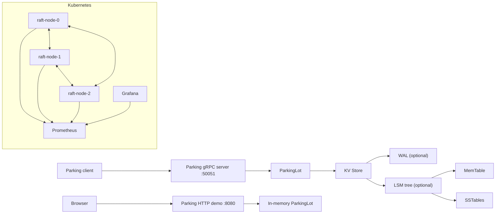

# Architecture

## 1. Problem

The project demonstrates software components that could support a smart parking availability service: request handling, storage, consensus experiments, containerization, orchestration, and metrics. It is an educational prototype rather than a production design.

## 2. Architecture overview

The parking and Raft paths are currently separate. `cmd/server` registers the parking RPC service backed by a `ParkingLot`; `cmd/parking-web` serves the browser demo and JSON API using its own in-memory `ParkingLot`; `cmd/raft-node` starts the Raft RPC server and network runtime. Parking operations do not enter the Raft log.

## 3. Key-value store

`kv.Store` protects its in-memory map with a read/write mutex. It optionally writes mutations to a WAL and/or an LSM tree. Reads consult the LSM tree when configured and otherwise fall back to the in-memory map.

## 4. WAL

`wal.WAL` appends PUT/DELETE records and synchronizes each write. `Replay` parses records and restores the file position to the end. The delimiter-based format is a simple demo format and does not escape delimiter characters.

## 5. LSM tree

`lsm.LSMTree` writes to a MemTable and flushes it to SSTables at a configured size. Reads check the MemTable and then SSTables newest-first; tombstones represent deletes. Bloom-filter and compaction components are present in the package, but full persistent manifest recovery/reconstruction after process restart is not complete.

## 6. gRPC

`proto/parking.proto` defines parking Enter/Exit/Status and Raft RequestVote/AppendEntries RPCs. Generated Go sources are checked into `proto/`. The parking server listens on port 50051; Raft nodes listen on port 6000.

## 7. Raft

The Raft package contains in-memory term, vote, log, commit, and node-state fields; a gRPC network runtime handles peer elections and AppendEntries heartbeats. The implementation is educational. It lacks complete persistent Raft metadata and should not be interpreted as production-grade consensus.

## 8. Docker

`Dockerfile.raft` builds `cmd/raft-node` into the Raft image; `Dockerfile.app` builds the browser/API app. Local Kubernetes can use locally loaded images, while AKS pulls versioned images from Azure Container Registry.

## 9. Kubernetes

`k8s/raft-config.yaml` supplies peer DNS addresses. `k8s/raft-node.yaml` defines a headless Service and a three-replica StatefulSet. Pod hostnames determine Raft node IDs; the manifest sets `NODE_ID` from the pod name so each replica derives its ordinal from `metadata.name`.

## 10. Helm

`helm/smart-parking/` packages the ConfigMap, headless Service, three-node StatefulSet, parking HTTP app, and optional ingress/TLS settings.

## 11. Prometheus

Each Raft node exposes `/metrics` on port 8080. Gauges report the current term, whether the process currently believes it is leader, commit index, and log entry count. The Raft gRPC server records request counts and latency histograms for RequestVote and AppendEntries. Prometheus scrapes each raw StatefulSet pod through its stable DNS name.

## 12. Grafana

Grafana is provisioned with Prometheus as its data source and a dashboard for leader state, term, commit index, RPC volume/rate/latency, and scrape availability.

## 13. Fault tolerance

Kubernetes recreates pods owned by the StatefulSet. This verifies process orchestration and peer reconnection, not persistence or full Raft safety. In particular, a restarted node begins with in-memory state and parking commands are not replicated through Raft.
